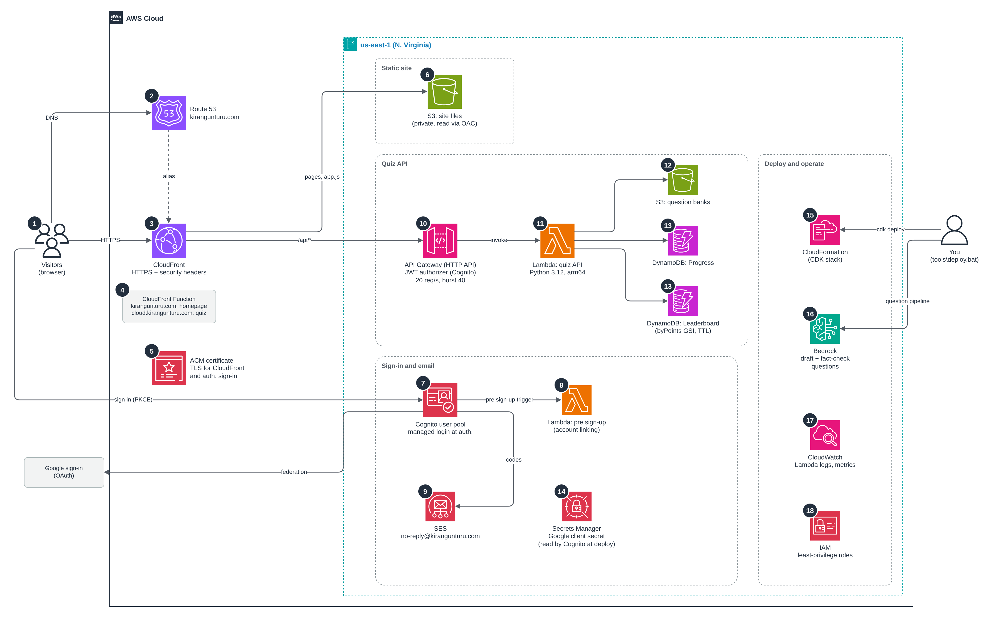
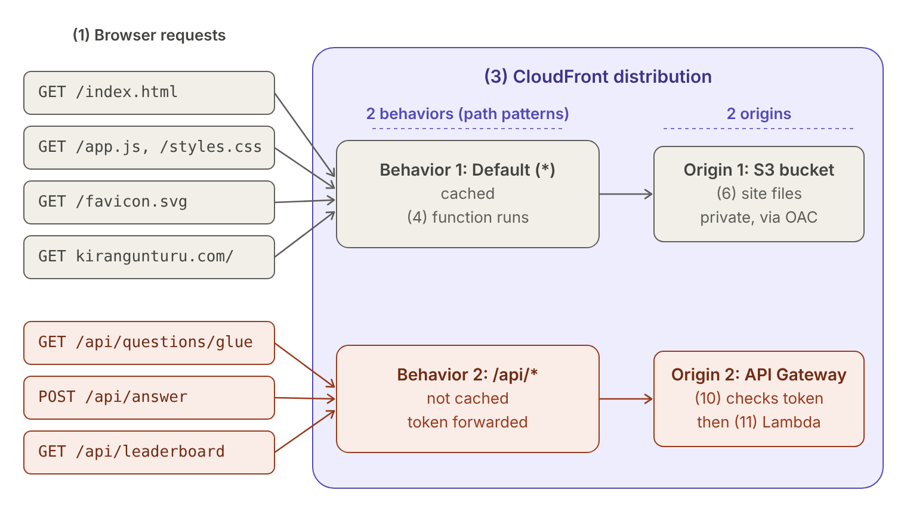

# Know Your Cloud

Short, practical AWS quizzes for engineers, with an explanation for every answer.

- Quiz: https://cloud.kirangunturu.com
- Author: https://kirangunturu.com

## Architecture

*Click the diagram for full size. Editable source: [docs/architecture.drawio](docs/architecture.drawio).*

Everything runs in one AWS account in us-east-1 and is created by a single CDK stack.

## How the data flows

The numbers below match the numbers on the diagram.

**Opening the site**

1. **Browser.** You type `https://cloud.kirangunturu.com` into your browser and press Enter.
2. **Route 53.** A name like `cloud.kirangunturu.com` is only a label. To open a connection, the browser
   needs the IP address of the server that will answer for that name, so it asks DNS. Route 53 holds the
   `kirangunturu.com` records. `cloud` has two alias records pointing to the CloudFront distribution: an
   **A** record (IPv4 addresses) and an **AAAA** record (IPv6 addresses). Route 53 resolves the alias and
   returns the IP addresses of a CloudFront edge server near you. The browser tries IPv6 first and falls
   back to IPv4. It never learns where the S3 bucket or the Lambda is; CloudFront is the only server it
   talks to.
3. **CloudFront.** The browser opens an HTTPS connection to that edge server and sends the request.
   The distribution has two **origins** (the places CloudFront fetches from) and two **behaviors** (rules
   that pick an origin by URL path):

   | Behavior (path) | Origin | Caching |
   |---|---|---|
   | `/api/*` | API Gateway | Off. Every call goes to the API, with your `Authorization` header forwarded. |
   | Default (`*`, everything else) | S3 site bucket | On. Pages, styles and scripts are served from the edge cache. |

   Because both live behind one domain, the browser only ever talks to `cloud.kirangunturu.com`, with no
   cross-site calls. The S3 bucket is private and only CloudFront can read it, through Origin Access Control.
4. **CloudFront Function.** This runs only on the default behavior, before CloudFront looks at the cache.
   It checks which name you typed: `kirangunturu.com` gets the personal homepage (`/home/index.html`),
   `cloud.kirangunturu.com` gets the quiz. Any other path on the bare domain is redirected to `cloud.`.
5. **ACM.** The HTTPS connection is secured with the free certificate from ACM, so the browser shows the lock.
6. **S3 (site files).** CloudFront fetches the page, styles and JavaScript from a private S3 bucket (or from its
   cache) and returns them. The quiz app now runs in your browser.

#### Which CloudFront behavior handles a request

The distribution has **two origins** (the S3 site bucket and API Gateway) and **two behaviors** (path patterns),
and each behavior sends its requests to one origin. CloudFront picks a behavior by the URL path alone. Paths that start with `/api/` use the API behavior;
everything else uses the default. The numbers match the architecture diagram.

**Default behavior: the page loads (1 → 3 → 4 → 6).**

- `index.html`, `app.js`, `styles.css`, icons and the favicon.
- A visit to `kirangunturu.com`. The function (4) rewrites it to `/home/index.html`, which lives in the same S3 bucket.
- These files are the same for every visitor, so CloudFront caches them. Most visits are answered at the edge
  without touching S3.

**`/api/*` behavior: every call the quiz app makes for data (1 → 3 → 10 → 11, then 12 or 13).**

- `GET /api/questions/glue` when you open a topic. Lambda (11) reads the question bank from S3 (12).
- `POST /api/start` and `POST /api/answer` when you view and answer a question. Lambda writes your score to DynamoDB (13).
- `GET /api/progress`, `/api/leaderboard` and `/api/profile` for your home screen, the rankings and your name.
- These responses are personal or change every second, so they are never cached. Your sign-in token from
  Cognito (7) is passed along so API Gateway can check it.

A single visit uses both: the default behavior once to get the app into your browser, then `/api/*` for nearly
every click. On the architecture diagram, the arrow from CloudFront (3) to S3 site files (6) is the default
behavior, and the arrow from CloudFront (3) to API Gateway (10) is the `/api/*` behavior.

**Why two behaviors and not one?** The two kinds of traffic need opposite settings:

| | Default (`*`) → S3 | `/api/*` → API Gateway |
|---|---|---|
| **What's returned** | The same files for everyone | Your own data (progress, score, unanswered questions) |
| **Caching** | On. The edge keeps copies. | Off. Every user calls the same URL (for example `/api/progress`) but gets different data. The cache key is the URL, not your token, so a cached copy of your progress would be served to the next user. Adding the token to the key would not help either: each copy serves one person and goes stale as soon as you answer a question. |
| **Methods** | GET and HEAD only | GET, POST and PUT |
| **Headers forwarded** | None, so everyone shares one cached copy | `Authorization` and query strings. `Host` is dropped because API Gateway only accepts its own host name. |
| **CloudFront Function** | Runs (homepage or quiz) | Not attached |
| **HTTP** | Redirected to HTTPS | HTTPS only |

**Why put the API behind CloudFront at all?** The browser only ever talks to `cloud.kirangunturu.com`, which means:

- **No CORS.** The page and the API share one origin, so there is no extra preflight call.
- **A tighter security policy.** The CSP can say `connect-src 'self'`.
- **A hidden endpoint.** The real `execute-api` URL never appears in the browser.
- **One certificate and a nearby connection.** A single ACM certificate covers both, and API calls start at the nearest edge.

**Signing in**

7. **Cognito.** You click **Continue with Google** or **Sign up with email**. The browser goes to Cognito's sign-in
   pages at `auth.kirangunturu.com`. For Google, Cognito sends you to Google and receives your profile back.
   Cognito then returns the browser to the quiz with a one-time code, which the app exchanges for sign-in tokens.
8. **Lambda (pre sign-up).** The first time a new person signs in, Cognito runs this function. If a Google sign-in
   and an email account share the same address, it joins them so you keep one account and one score.
9. **SES.** If you signed up with email, Cognito sends your verification code through SES, from
   `no-reply@kirangunturu.com`.

**Taking a quiz**

10. **API Gateway.** When you pick a topic, the app calls `/api/questions/...` with your sign-in token. CloudFront
    forwards anything under `/api/*` to API Gateway, which checks the token is valid and that you're within the
    rate limit. Requests without a valid token stop here.
11. **Lambda (quiz API).** API Gateway passes the request to the quiz function, along with who you are.
12. **S3 (question banks).** The function reads the topic's questions from a second private bucket and sends them
    back **without the answers**.
13. **DynamoDB.** When you answer, the app sends your choice to `/api/answer`. The function grades it on the server,
    returns the right answer and explanation, and, if it was your first correct answer to that question, adds a
    point to the weekly and all-time leaderboards. Your best scores and missed questions are saved to your account.

**Behind the scenes**

14. **Secrets Manager.** Holds the Google sign-in secret. Cognito reads it when the stack is deployed, so it never
    appears in code.
15. **CloudFormation (CDK).** One command, `tools\deploy.bat`, creates or updates every resource above from code.
16. **Bedrock.** Before questions reach the site, Bedrock drafts them from my notes and decks and runs a separate
    fact-check. This happens on my computer, not in the live site.
17. **CloudWatch.** Keeps the Lambda logs and metrics, for troubleshooting.
18. **IAM.** Gives each part only the permissions it needs. For example, only the quiz function can read the
    question bucket.

## What each AWS service does

| # | Service | Role in this project |
|---|---|---|
| 1 | **Browser** (not AWS) | Runs the quiz app: plain HTML, CSS and JavaScript that call the API with the visitor's sign-in token. |
| 2 | **Route 53** | Hosts the domain and points `kirangunturu.com`, `cloud.kirangunturu.com` and `auth.kirangunturu.com` to the right places. |
| 3 | **CloudFront** | Serves the site over HTTPS from edge locations, adds security headers, and forwards `/api/*` calls to the API. |
| 4 | **CloudFront Function** | Routes by host name: homepage on `kirangunturu.com`, quiz on `cloud.kirangunturu.com`. |
| 5 | **ACM** | Provides the free TLS certificate for the site and the sign-in pages. |
| 6 | **S3 (site files)** | Private bucket with the website files. Only CloudFront can read it. |
| 7 | **Cognito** | Handles sign-in, with Google or email and password, on hosted pages at `auth.kirangunturu.com`. |
| 8 | **Lambda (pre sign-up)** | Joins a Google sign-in and an email account with the same address, so each person has one account. |
| 9 | **SES** | Sends sign-up and password-reset codes from `no-reply@kirangunturu.com`. |
| 10 | **API Gateway** | Checks every request's sign-in token, routes it to Lambda, and limits traffic to 20 requests per second. |
| 11 | **Lambda (quiz API)** | Sends questions without answers, grades answers on the server, awards points, and saves progress. |
| 12 | **S3 (question banks)** | Private bucket with the questions. Only the quiz API can read it. |
| 13 | **DynamoDB** | Two tables: each user's progress, and the weekly and all-time leaderboards. |
| 14 | **Secrets Manager** | Stores the Google sign-in secret so it never appears in code or config files. |
| 15 | **CloudFormation (CDK)** | Creates and updates all of the above from code with one deploy command. |
| 16 | **Bedrock** | Drafts and fact-checks quiz questions from my notes and decks. Runs on my computer, not in the live site. |
| 17 | **CloudWatch** | Keeps Lambda logs and metrics for troubleshooting. |
| 18 | **IAM** | Gives each Lambda function only the permissions it needs. |
