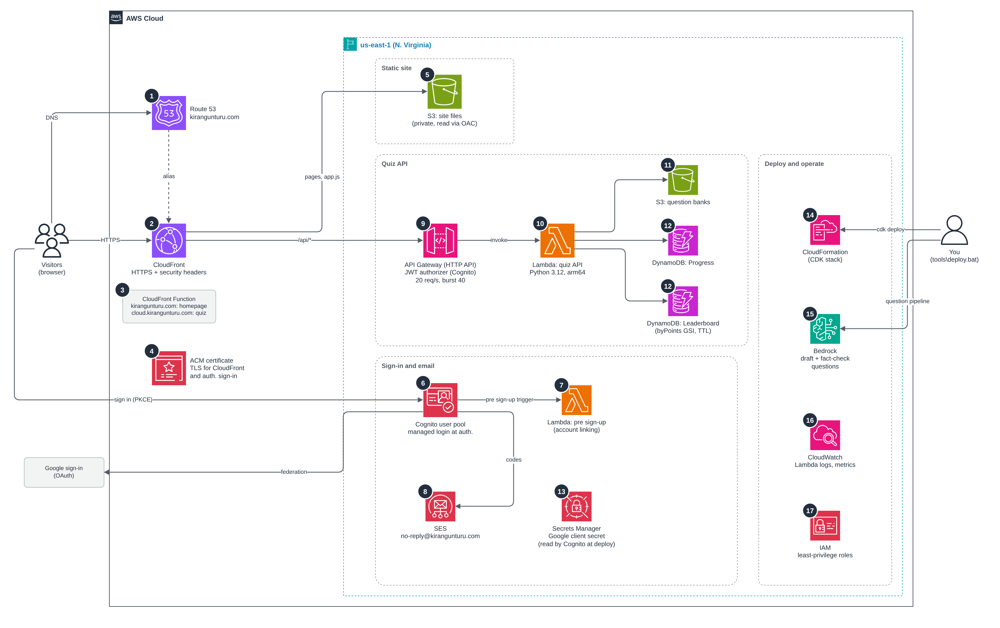

# Know Your Cloud

Short, practical AWS quizzes for engineers, with an explanation for every answer.

- Quiz: https://cloud.kirangunturu.com
- Author: https://kirangunturu.com

## Architecture

*Click the diagram for full size. Editable source: [docs/architecture.drawio](docs/architecture.drawio).*

Everything runs in one AWS account in us-east-1 and is created by a single CDK stack. The numbers on the
diagram match the steps and the table below.

## How the data flows

**Opening the site**

1. The browser looks up `cloud.kirangunturu.com` in **Route 53**, which points it at CloudFront.
2. **CloudFront** receives the request over HTTPS.
3. A **CloudFront Function** checks the host name: `kirangunturu.com` gets the homepage, `cloud.kirangunturu.com` gets the quiz.
4. The HTTPS connection uses the **ACM** certificate.
5. CloudFront returns the pages, styles and script from the private **S3** site bucket.

**Signing in**

6. The visitor signs in on **Cognito**'s hosted pages at `auth.kirangunturu.com`, with Google or with email and password.
7. On a first sign-in, the **pre sign-up Lambda** links a Google sign-in and an email account that share the same address.
8. For email sign-up, Cognito sends the verification code through **SES**.

**Taking a quiz**

9. The browser calls `/api/*` with its sign-in token. CloudFront forwards it to **API Gateway**, which checks the token and the rate limit.
10. API Gateway invokes the **quiz API Lambda**.
11. The Lambda reads the question bank from the private **S3** questions bucket and sends questions without their answers.
12. When an answer comes back, the Lambda grades it and writes progress and leaderboard points to **DynamoDB**.

**Behind the scenes**

13. **Secrets Manager** holds the Google sign-in secret that Cognito uses.
14. **CloudFormation** (through CDK) creates and updates everything above with one deploy.
15. **Bedrock** drafts and fact-checks the quiz questions on my computer before they are published.
16. **CloudWatch** keeps the Lambda logs and metrics.
17. **IAM** gives each part only the permissions it needs.

## What each AWS service does

| # | Service | Role in this project |
|---|---|---|
| 1 | **Route 53** | Hosts the domain and points `kirangunturu.com`, `cloud.kirangunturu.com` and `auth.kirangunturu.com` to the right places. |
| 2 | **CloudFront** | Serves the site over HTTPS from edge locations, adds security headers, and forwards `/api/*` calls to the API. |
| 3 | **CloudFront Function** | Routes by host name: homepage on `kirangunturu.com`, quiz on `cloud.kirangunturu.com`. |
| 4 | **ACM** | Provides the free TLS certificate for the site and the sign-in pages. |
| 5 | **S3 (site files)** | Private bucket with the website files. Only CloudFront can read it. |
| 6 | **Cognito** | Handles sign-in, with Google or email and password, on hosted pages at `auth.kirangunturu.com`. |
| 7 | **Lambda (pre sign-up)** | Joins a Google sign-in and an email account with the same address, so each person has one account. |
| 8 | **SES** | Sends sign-up and password-reset codes from `no-reply@kirangunturu.com`. |
| 9 | **API Gateway** | Checks every request's sign-in token, routes it to Lambda, and limits traffic to 20 requests per second. |
| 10 | **Lambda (quiz API)** | Sends questions without answers, grades answers on the server, awards points, and saves progress. |
| 11 | **S3 (question banks)** | Private bucket with the questions. Only the quiz API can read it. |
| 12 | **DynamoDB** | Two tables: each user's progress, and the weekly and all-time leaderboards. |
| 13 | **Secrets Manager** | Stores the Google sign-in secret so it never appears in code or config files. |
| 14 | **CloudFormation (CDK)** | Creates and updates all of the above from code with one deploy command. |
| 15 | **Bedrock** | Drafts and fact-checks quiz questions from my notes and decks. Runs on my computer, not in the live site. |
| 16 | **CloudWatch** | Keeps Lambda logs and metrics for troubleshooting. |
| 17 | **IAM** | Gives each Lambda function only the permissions it needs. |
