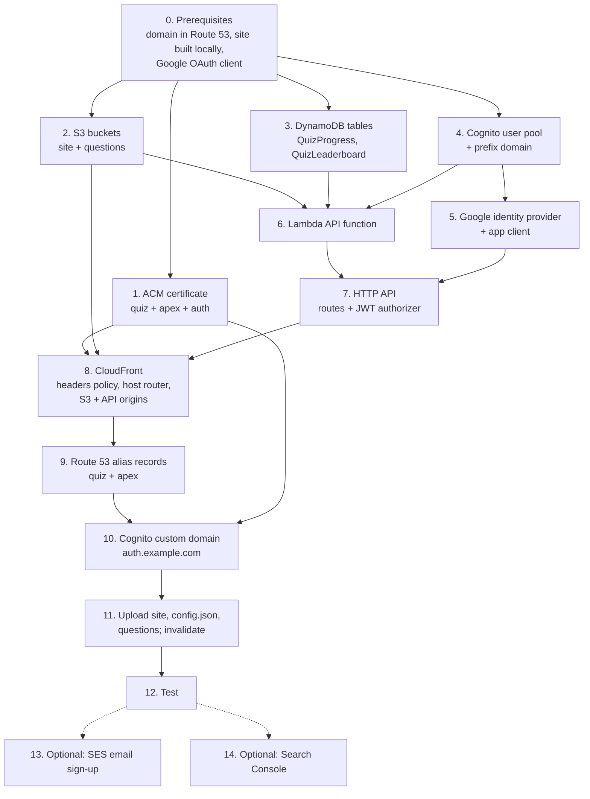
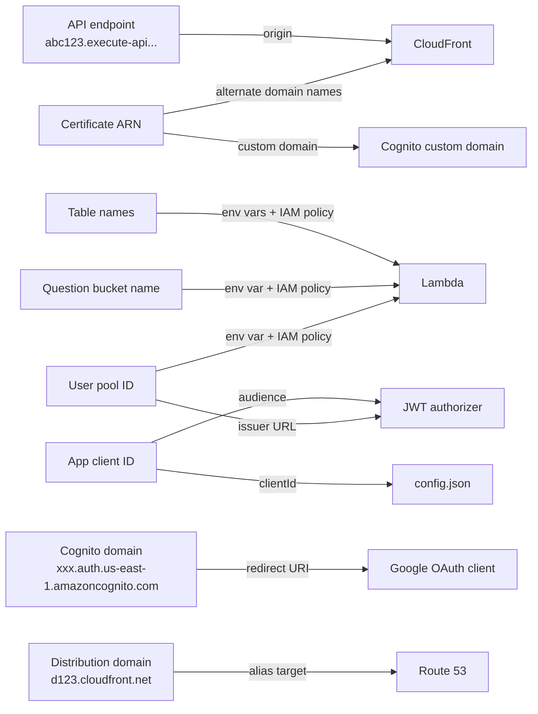
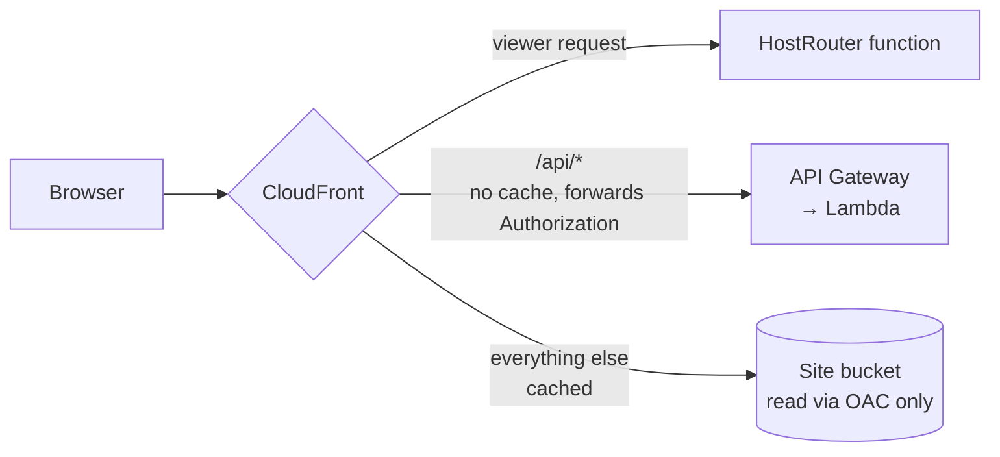
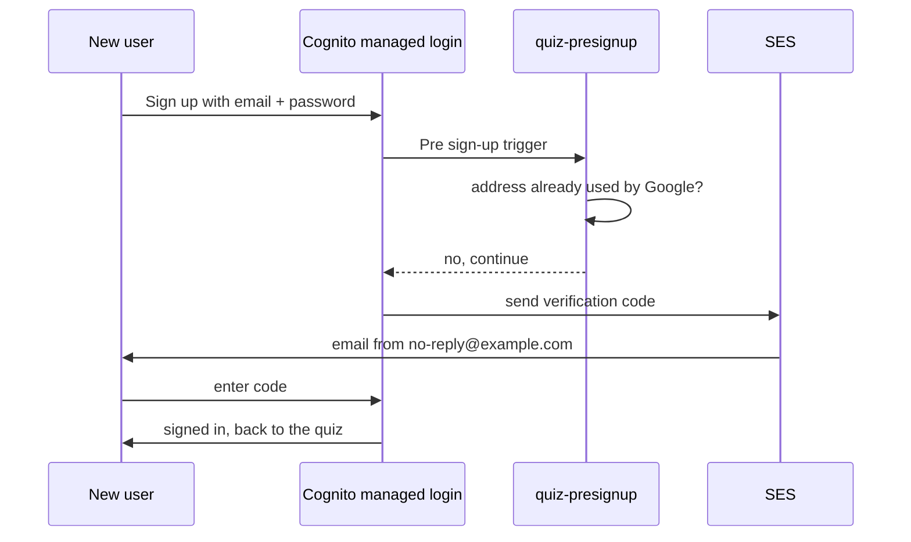

# Building Know Your Cloud by hand in the AWS console

This guide creates the same infrastructure as `tools\deploy.bat` (the CDK stack in
`infra/quiz_site_stack.py`), one console screen at a time. Use it to learn how the pieces fit, to
rebuild in an account where you can't run CDK, or to see where each setting lives.

> **Use one method per account.** If you already deployed with CDK, don't edit those resources in the
> console: the next `cdk deploy` would undo or fight your changes. Practise in a second account or
> region, or tear the CDK stack down first.

**Time:** about 2 hours the first time, plus waiting for the certificate and DNS.
**Region:** do everything in **US East (N. Virginia) `us-east-1`**. CloudFront only accepts
certificates from there, and keeping everything in one region keeps the steps simple.
**Names:** this guide uses `example.com` as the domain, `quiz.example.com` for the quiz,
`auth.example.com` for sign-in, and table and bucket names like `QuizProgress`. Use your own. The live
site uses `kirangunturu.com`, `cloud.kirangunturu.com` and `auth.kirangunturu.com`.

> Console labels change from time to time. If a button has moved, look for the same setting on the
> same page; the values here are what matter.

---

## Contents

0. [Before you start](#0-before-you-start)
1. [Certificate (ACM)](#1-certificate-acm)
2. [S3 buckets](#2-s3-buckets)
3. [DynamoDB tables](#3-dynamodb-tables)
4. [Cognito user pool](#4-cognito-user-pool)
5. [Google sign-in](#5-google-sign-in)
6. [Lambda function for the API](#6-lambda-function-for-the-api)
7. [API Gateway HTTP API](#7-api-gateway-http-api)
8. [CloudFront](#8-cloudfront)
9. [Route 53 records for the site](#9-route-53-records-for-the-site)
10. [Cognito custom sign-in domain](#10-cognito-custom-sign-in-domain)
11. [Upload the site and the questions](#11-upload-the-site-and-the-questions)
12. [Test it](#12-test-it)
13. [Optional: email sign-up through SES](#13-optional-email-sign-up-through-ses)
14. [Optional: Google Search Console](#14-optional-google-search-console)
15. [Updating, monitoring and tearing down](#15-updating-monitoring-and-tearing-down)

---

## The order, and why

Most steps need a value from an earlier one (an ARN, an ID or a domain name). Follow this order and
every value you need already exists:



### Values you'll copy between steps

Keep a scratch note with these as you go. Each one is created in one step and pasted into later ones:



| Value | Created in | Used in |
|---|---|---|
| Certificate ARN | Step 1 | Steps 8, 10 |
| Site bucket name | Step 2 | Steps 8, 11 |
| Question bucket name | Step 2 | Steps 6, 11 |
| Table names | Step 3 | Step 6 |
| User pool ID (`us-east-1_AbCdEf123`) | Step 4 | Steps 6, 7 |
| Cognito prefix domain | Step 4 | Steps 5, 11 |
| App client ID | Step 5 | Steps 7, 11 |
| API endpoint | Step 7 | Step 8 |
| Distribution domain (`d123.cloudfront.net`) | Step 8 | Step 9 |
| Your AWS account ID | top right of the console | IAM policies |

---

## 0. Before you start

1. **An AWS account** with permission to create the services below, signed in with an IAM user or
   role (not the root user). Turn on MFA for both.
2. **A domain in Route 53.** **Route 53 → Registered domains → Register domains**. Registering there
   creates the **hosted zone** automatically. Wait until the domain status is active and you've clicked
   the verification email.
3. **The site built on your computer.** First put your domains in `.env` (copy `.env.example`), so
   the homepage, canonical links and sitemaps use the right addresses:

   ```
   SITE_DOMAIN=quiz.example.com
   HOSTED_ZONE=example.com
   ```

   Then, in the project folder:

   ```bat
   pip install -r requirements.txt
   python tools\build_site.py
   ```

   This creates `dist\` (the public site) and `dist-data\` (one question bank per topic). You'll upload
   both in step 11.
4. **A Google OAuth client**, if you want Google sign-in. You create it in step 5 because it needs the
   Cognito domain from step 4.

---

## 1. Certificate (ACM)

One free certificate covers the quiz, the bare domain and the sign-in domain.

1. Open **Certificate Manager**. Check that the region at the top right is **N. Virginia**.
2. **Request → Request a public certificate → Next.**
3. **Fully qualified domain name:** `quiz.example.com`. Click **Add another name to this certificate**
   twice and add `example.com` and `auth.example.com`.
4. **Validation method:** DNS validation. **Key algorithm:** RSA 2048. **Request.**
5. Open the new certificate. Under **Domains**, click **Create records in Route 53**, select all three
   and click **Create records**.
6. Wait for **Status: Issued**, usually 5 to 30 minutes. Copy the **certificate ARN**.

---

## 2. S3 buckets

Two private buckets: one for the public site files (served only through CloudFront) and one for the
question banks (read only by the API).

**Site bucket**

1. **S3 → Create bucket.** Type: General purpose. Name: e.g. `knowyourcloud-site-<account-id>` (bucket
   names are global, so add something unique).
2. **Object Ownership:** ACLs disabled (Bucket owner enforced).
3. **Block Public Access:** leave **all four** boxes ticked. CloudFront will read the bucket through
   Origin Access Control, so it never needs to be public.
4. **Bucket Versioning:** optional. **Default encryption:** SSE-S3. **Create bucket.**

**Question bucket**

Repeat with a name like `knowyourcloud-questions-<account-id>`, with the same settings.

**Require HTTPS on both** (what CDK's `enforce_ssl` does): open each bucket, then **Permissions →
Bucket policy → Edit**, and add:

```json
{
  "Version": "2012-10-17",
  "Statement": [{
    "Sid": "DenyInsecureTransport",
    "Effect": "Deny",
    "Principal": "*",
    "Action": "s3:*",
    "Resource": ["arn:aws:s3:::BUCKET-NAME", "arn:aws:s3:::BUCKET-NAME/*"],
    "Condition": { "Bool": { "aws:SecureTransport": "false" } }
  }]
}
```

The site bucket gets one more statement in step 8 (CloudFront offers to copy it for you).

---

## 3. DynamoDB tables

**Progress** (one item per user)

1. **DynamoDB → Tables → Create table.**
2. **Table name:** `QuizProgress`. **Partition key:** `userId` (String). No sort key.
3. **Table settings:** Customize settings → **Capacity mode: On-demand**.
4. **Create table.** When it's active: **Backups → Point-in-time recovery → Edit → Turn on.**

**Leaderboard** (board totals and "already answered" markers)

1. **Create table.** Name: `QuizLeaderboard`. **Partition key:** `pk` (String). **Sort key:** `sk`
   (String). Capacity mode: **On-demand**.
2. Under **Secondary indexes → Create global index:**
   - Partition key `pk` (String), sort key `points` (**Number**)
   - Index name `byPoints`, attribute projections **All**
3. **Create table.** Then:
   - **Additional settings → Time to Live (TTL) → Turn on**, with attribute name `expires`. Weekly
     rows and markers delete themselves through this.
   - **Backups → Point-in-time recovery → Turn on.**
   - Optional: **Additional settings → Deletion protection → Turn on**, on both tables.

---

## 4. Cognito user pool

1. **Cognito → User pools → Create user pool.** The console starts with a short wizard:
   - **Application type:** Single-page application (SPA). **Name your application:** `aws-quiz-web`.
   - **Options for sign-in identifiers:** Email.
   - **Self-registration:** off for Google-only (on if you'll add email sign-up in step 13).
   - **Required attributes for sign-up:** email.
   - **Return URL:** `https://quiz.example.com/`
   - **Create user directory.**
2. Open the new pool and copy the **User pool ID**. Then adjust:
   - **Settings → Feature plan:** Essentials (needed for the newer managed login pages).
   - **Authentication methods → Password policy → Edit:** custom; minimum length **10**; untick
     "special character".
   - **Sign-up → Attribute verification and user account confirmation:** send email message, verify
     email address.
   - **Sign-in / account recovery:** **Email only**.
   - **Settings → Deletion protection:** On.
3. **Domain** (under Branding): the wizard usually created a prefix domain. If not, **Actions → Create
   Cognito domain**, choose a prefix (it can't contain "aws", "amazon" or "cognito") and set **Branding
   version: Managed login**. Copy the full domain, e.g. `https://quiz-1a2b3c.auth.us-east-1.amazoncognito.com`.
4. **Managed login → Styles:** make sure your app client has a style. If none is listed, **Create a
   style**, choose your client, and keep the defaults. You can restyle it later.

---

## 5. Google sign-in

**In Google Cloud** (https://console.cloud.google.com → any project → **Google Auth Platform**):

1. **Branding:** app name `Know Your Cloud`, support email, and under **Authorized domains** add
   `amazoncognito.com` and your own `example.com`.
2. **Audience:** External, then **Publish app** (in "Testing" only listed users can sign in).
3. **Clients → Create client → Web application:**
   - **Authorized JavaScript origins:** your Cognito domain from step 4, plus `https://auth.example.com`
   - **Authorized redirect URIs:** `<cognito domain>/oauth2/idpresponse` and
     `https://auth.example.com/oauth2/idpresponse`
   - Copy the **client ID** and **client secret**.

**In Cognito** (your pool):

1. **Authentication → Social and external providers → Add identity provider → Google.**
2. Paste the client ID and secret. **Authorized scopes:** `openid email profile`.
3. **Map attributes** (user pool attribute ← Google attribute):

   | User pool attribute | Google attribute |
   |---|---|
   | email | email |
   | given_name | given_name |
   | family_name | family_name |
   | name | name |
   | email_verified | email_verified |

4. **Add identity provider.**

**The app client:** open **Applications → App clients → aws-quiz-web**.

1. **App client information → Edit:**
   - No client secret.
   - Authentication flows: none ticked except refresh tokens (`ALLOW_REFRESH_TOKEN_AUTH`). The site
     only uses the managed pages.
   - Token expiration: access **60 min**, ID **60 min**, refresh **30 days**.
   - **Enable token revocation** on. **Prevent user existence errors** on.
2. **Login pages → Edit managed login pages configuration:**
   - **Allowed callback URLs:** `https://quiz.example.com/` and `https://example.com/`
   - **Allowed sign-out URLs:** the same two
   - **Identity providers:** **Google** only (add **Cognito user pool** in step 13 for email sign-up)
   - **OAuth 2.0 grant types:** Authorization code grant
   - **OpenID Connect scopes:** `openid`, `email`
3. Copy the **Client ID**.

---

## 6. Lambda function for the API

**Package the code.** On your computer, put `infra\api\handler.py` in a zip by itself, with the file
at the top level of the zip (in Explorer: right-click `handler.py` → **Send to → Compressed (zipped)
folder**).

**Create the function**

1. **Lambda → Create function → Author from scratch.**
2. **Name:** `quiz-api`. **Runtime:** Python 3.12. **Architecture:** arm64.
3. **Execution role:** Create a new role with basic Lambda permissions. This lets it write logs.
4. **Create function.** Then:
   - **Code → Upload from → .zip file**, and choose your zip.
   - **Runtime settings → Edit:** handler `handler.handler`.
   - **Configuration → General configuration → Edit:** memory **256 MB**, timeout **10 sec**.
   - **Configuration → Environment variables → Edit:**

     | Key | Value |
     |---|---|
     | `PROGRESS_TABLE` | `QuizProgress` |
     | `LEADERBOARD_TABLE` | `QuizLeaderboard` |
     | `DATA_BUCKET` | your question bucket name |
     | `USER_POOL_ID` | your user pool ID |

**Give it exactly the access it needs.** **Configuration → Permissions →** click the role name (opens
IAM) **→ Add permissions → Create inline policy → JSON**, then paste with your values:

```json
{
  "Version": "2012-10-17",
  "Statement": [
    {
      "Sid": "Tables",
      "Effect": "Allow",
      "Action": ["dynamodb:GetItem", "dynamodb:PutItem", "dynamodb:UpdateItem",
                 "dynamodb:Query", "dynamodb:ConditionCheckItem"],
      "Resource": [
        "arn:aws:dynamodb:us-east-1:ACCOUNT_ID:table/QuizProgress",
        "arn:aws:dynamodb:us-east-1:ACCOUNT_ID:table/QuizLeaderboard",
        "arn:aws:dynamodb:us-east-1:ACCOUNT_ID:table/QuizLeaderboard/index/byPoints"
      ]
    },
    {
      "Sid": "Questions",
      "Effect": "Allow",
      "Action": "s3:GetObject",
      "Resource": "arn:aws:s3:::QUESTION_BUCKET/questions/*"
    },
    {
      "Sid": "PlayerNames",
      "Effect": "Allow",
      "Action": ["cognito-idp:AdminGetUser", "cognito-idp:AdminUpdateUserAttributes"],
      "Resource": "arn:aws:cognito-idp:us-east-1:ACCOUNT_ID:userpool/USER_POOL_ID"
    }
  ]
}
```

Name it `quiz-api-access` and **Create policy**.

**Log retention:** **CloudWatch → Log groups → /aws/lambda/quiz-api → Actions → Edit retention →
1 month.** The log group appears after the first invocation.

---

## 7. API Gateway HTTP API

1. **API Gateway → Create API → HTTP API → Build.**
2. **Integrations → Add integration → Lambda**, choose `quiz-api`. **API name:** `aws-quiz-api`.
   **Next.**
3. **Configure routes.** Add each one with the `quiz-api` integration:

   | Method | Path |
   |---|---|
   | GET | `/api/questions/{id}` |
   | POST | `/api/answer` |
   | GET | `/api/leaderboard` |
   | GET | `/api/progress` |
   | PUT | `/api/progress` |
   | GET | `/api/profile` |
   | PUT | `/api/profile` |

4. **Stages:** keep `$default` with **auto-deploy** on. **Next → Create.**
5. **Authorization → Manage authorizers → Create:**
   - Type **JWT**, name `CognitoJwt`
   - **Identity source:** `$request.header.Authorization`
   - **Issuer URL:** `https://cognito-idp.us-east-1.amazonaws.com/<USER_POOL_ID>`
   - **Audience:** your app client ID
   - **Create**, then on **Attach authorizers to routes**, attach `CognitoJwt` to **every** route.
6. **Throttling:** **Protect → Throttling → Edit** the `$default` stage default: rate **20**, burst
   **40**.
7. Copy the **Invoke URL** domain, e.g. `abc123.execute-api.us-east-1.amazonaws.com`, without
   `https://`.

The console also adds a resource policy on the Lambda function so API Gateway may invoke it. Check
**Lambda → quiz-api → Configuration → Permissions → Resource-based policy** if a call returns 500.

---

## 8. CloudFront

### 8a. Response headers policy (security headers)

**CloudFront → Policies → Response headers → Create response headers policy.**

- **Name:** `quiz-security-headers`
- **Security headers:** tick each and **Origin override** for each:
  - **Strict-Transport-Security:** max-age `31536000`, includeSubDomains
  - **X-Content-Type-Options:** nosniff
  - **X-Frame-Options:** DENY
  - **Referrer-Policy:** strict-origin-when-cross-origin
  - **Content-Security-Policy** (one line; use your sign-in domain):

    ```
    default-src 'self'; script-src 'self'; style-src 'self' https://fonts.googleapis.com; font-src https://fonts.gstatic.com; img-src 'self' data:; connect-src 'self' https://auth.example.com; object-src 'none'; base-uri 'self'; form-action 'self'; frame-ancestors 'none'
    ```

    Until step 10 is done, put your amazoncognito.com domain in `connect-src` instead of
    `https://auth.example.com`, otherwise sign-in can't fetch tokens.

### 8b. Host router function (homepage on the bare domain)

**CloudFront → Functions → Create function.** Name `HostRouter`, runtime **cloudfront-js-2.0**. In the
**Development** tab, replace the code with the following, using your own domains, then **Save
changes → Publish**:

```js
function handler(event) {
  var req = event.request;
  var host = req.headers.host ? req.headers.host.value.toLowerCase() : "";
  var uri = req.uri;
  if (host === "example.com") {
    if (uri === "/" || uri === "/index.html") { req.uri = "/home/index.html"; return req; }
    if (uri === "/robots.txt" || uri === "/sitemap.xml") { req.uri = "/home" + uri; return req; }
    if (uri === "/favicon.svg" || uri.indexOf("/home/") === 0) return req;
    return redirect("https://quiz.example.com" + uri + query(req.querystring));
  }
  if (uri === "/home" || uri === "/home/" || uri === "/home/index.html") return redirect("https://example.com/");
  return req;
}
function query(qs) {
  var parts = [];
  for (var k in qs) {
    var v = qs[k];
    if (v.multiValue) { for (var i = 0; i < v.multiValue.length; i++) parts.push(k + "=" + v.multiValue[i].value); }
    else parts.push(v.value === "" ? k : k + "=" + v.value);
  }
  return parts.length ? "?" + parts.join("&") : "";
}
function redirect(url) {
  return { statusCode: 301, statusDescription: "Moved Permanently",
           headers: { location: { value: url }, "cache-control": { value: "max-age=3600" } } };
}
```

Use the **Test** tab to try it: set the Host header to `example.com` with URI `/` and check that the
result's URI becomes `/home/index.html`.

### 8c. The distribution

**CloudFront → Distributions → Create distribution.** The newer console asks a few plan questions
first; pick the pay-as-you-go / single-site options, and use "Customize" or the classic settings page
to set the following.

**Origin 1: the site bucket**

- **Origin domain:** choose your site bucket (`knowyourcloud-site-....s3.us-east-1.amazonaws.com`)
- **Origin access:** **Origin access control settings (recommended) → Create new OAC** (sign
  requests, S3 type)

**Default cache behavior**

- **Viewer protocol policy:** Redirect HTTP to HTTPS
- **Allowed HTTP methods:** GET, HEAD
- **Cache policy:** `CachingOptimized`
- **Response headers policy:** `quiz-security-headers`
- **Compress objects automatically:** Yes
- **Function associations → Viewer request:** CloudFront Functions → `HostRouter`

**Settings**

- **Price class:** Use North America and Europe
- **Alternate domain names (CNAMEs):** `quiz.example.com` and `example.com`
- **Custom SSL certificate:** the certificate from step 1
- **Security policy:** TLSv1.2_2021
- **Supported HTTP versions:** HTTP/2 and HTTP/3
- **Default root object:** `index.html`
- **WAF:** optional (adds cost). The API is already throttled.

**Create distribution.** A yellow banner offers the **S3 bucket policy** for the OAC. **Copy policy**,
open the site bucket → **Permissions → Bucket policy → Edit**, and add that statement next to the HTTPS
rule from step 2.

**Origin 2: the API.** In the distribution: **Origins → Create origin.**

- **Origin domain:** the API domain from step 7 (`abc123.execute-api.us-east-1.amazonaws.com`)
- **Protocol:** HTTPS only. Leave the origin path empty.

**Behavior for the API:** **Behaviors → Create behavior.**

- **Path pattern:** `/api/*`, **Origin:** the API origin
- **Viewer protocol policy:** HTTPS only
- **Allowed HTTP methods:** GET, HEAD, OPTIONS, PUT, POST, PATCH, DELETE
- **Cache policy:** `CachingDisabled`
- **Origin request policy:** `AllViewerExceptHostHeader`. This forwards the `Authorization` header
  and query string, but not `Host`, which API Gateway must not receive.
- **Response headers policy:** `quiz-security-headers`

**Error page (so S3's "access denied" for missing files becomes the app):** **Error pages → Create
custom error response:** HTTP error code **403**, customize → response page path `/index.html`, HTTP
response code **404**, error caching TTL **300**.

Copy the **distribution domain name** (`d123abc.cloudfront.net`). Deploying takes a few minutes.



---

## 9. Route 53 records for the site

**Route 53 → Hosted zones → example.com → Create record**, four times:

| Record name | Type | Alias | Route traffic to |
|---|---|---|---|
| `quiz` | A | Yes | Alias to CloudFront distribution → your distribution |
| `quiz` | AAAA | Yes | Same |
| *(blank, the apex)* | A | Yes | Same |
| *(blank, the apex)* | AAAA | Yes | Same |

Within a few minutes `https://quiz.example.com` serves the (still empty) site.

---

## 10. Cognito custom sign-in domain

Cognito only accepts `auth.example.com` once `example.com` has an A record, which step 9 created.

1. **Cognito → your pool → Branding → Domain → Actions → Create custom domain.**
2. **Domain:** `auth.example.com`. **ACM certificate:** the one from step 1. **Branding version:**
   Managed login. **Create.** This can take up to about 15 minutes.
3. Copy the **Alias target** it shows (a `*.cloudfront.net` name).
4. **Route 53 → example.com → Create record:** name `auth`, type **A**, alias **on**, **Alias to
   CloudFront distribution**, and paste that alias target.
5. Go back to the response headers policy (8a) and set `connect-src` to `https://auth.example.com`.

The amazoncognito.com prefix domain keeps working too.

---

## 11. Upload the site and the questions

**1. Create `config.json`** in your local `dist\` folder. This is the file CDK writes for you:

```json
{ "auth": { "domain": "https://auth.example.com", "clientId": "YOUR_APP_CLIENT_ID", "google": true, "email": false } }
```

**2. Upload the site.** **S3 → site bucket → Upload → Add files / Add folder.** Select **everything
inside** `dist\` (not the `dist` folder itself), so `index.html` lands at the top of the bucket next to
`app.js`, `config.json`, `data/`, `home/`, `icons/`, `robots.txt` and `sitemap.xml`.

Optional: under **Properties → Metadata**, add `Cache-Control: public, max-age=300` so browsers pick up
changes within 5 minutes.

**3. Upload the questions.** **S3 → question bucket → Create folder** `questions`, open it, and
upload every `*.json` file from `dist-data\`. The API reads `questions/<topic>.json`.

**4. Clear CloudFront's cache.** **CloudFront → your distribution → Invalidations → Create
invalidation → `/*`.**

---

## 12. Test it

| Check | Expected |
|---|---|
| `https://quiz.example.com` | Welcome page with "Continue with Google" |
| `https://example.com` | Your homepage (from `content/author.json`) |
| `https://example.com/anything` | 301 redirect to `https://quiz.example.com/anything` |
| `https://quiz.example.com/api/progress` in the browser | `{"message":"Unauthorized"}`. Good: the API is locked. |
| Continue with Google | Google consent naming `example.com`, back to the topic list |
| Take a quiz | Feedback after each answer, "+1 point" on correct first answers |
| Leaderboard | Your name as "First L." |
| DevTools → Network → `api/questions/...` | Questions with **no** `answer` or `explanation` fields |
| **Cognito → Users** | Your account, listed as `google_...` |
| **DynamoDB → QuizLeaderboard → Explore items** | Rows with `pk` = `ALL` and `W#YYYY-Www` |

If something fails:

| Symptom | Usually |
|---|---|
| Sign-in loops or "redirect_mismatch" | Callback URL in the app client must be exactly `https://quiz.example.com/` (with the slash) |
| Sign-in reaches the site, then nothing loads | `connect-src` in the CSP doesn't list your sign-in domain, or `config.json` has the wrong domain or client ID |
| API calls return 401 | Authorizer audience isn't the app client ID, or the issuer has the wrong pool ID |
| API calls return 403 from CloudFront | The `/api/*` behavior is missing or doesn't allow POST/PUT |
| API calls return 500 | Lambda logs in CloudWatch: usually a wrong env var or a missing IAM permission |
| Topic page says "unknown topic" | Questions are not under `questions/` in the question bucket |
| `AccessDenied` XML page | OAC bucket policy not added to the site bucket |

---

## 13. Optional: email sign-up through SES

Only do this if you want email + password next to Google. Cognito's built-in sender tends to land in
spam, so the codes go out through SES on your domain.

**13a. Verify the domain in SES**

1. **SES → Configuration → Identities → Create identity → Domain:** `example.com`.
2. Tick **Use a custom MAIL FROM domain:** `mail.example.com`. Behavior on MX failure: use default.
3. **Easy DKIM**, RSA 2048, and tick **Publish DNS records to Route 53**. SES adds the 3 DKIM CNAMEs and
   the MAIL FROM MX and SPF records itself, because the zone is in the same account.
4. **Route 53 → example.com → Create record:** name `_dmarc`, type TXT, value
   `"v=DMARC1; p=quarantine; adkim=r; aspf=r"`.
5. Wait for **Identity status: Verified**, usually under an hour.

**13b. Leave the SES sandbox.** **SES → Account dashboard → Request production access.** Mail type
**Transactional**, your website URL, and a description such as: "Sign-up verification codes and
password resets for a free quiz site, sent only to people who sign up themselves; bounces and
complaints handled by the SES account-level suppression list." AWS may ask follow-up questions; it
usually decides within a day. Until then SES only sends to addresses you've verified yourself.

**13c. The account-linking Lambda.** Same as step 6, but:

- Zip `infra\api\presignup.py`. Function name `quiz-presignup`, Python 3.12, arm64, handler
  `presignup.handler`, memory 128 MB, timeout 5 sec.
- Inline policy:

  ```json
  {
    "Version": "2012-10-17",
    "Statement": [{
      "Effect": "Allow",
      "Action": ["cognito-idp:ListUsers", "cognito-idp:AdminLinkProviderForUser", "cognito-idp:AdminDeleteUser"],
      "Resource": "arn:aws:cognito-idp:us-east-1:ACCOUNT_ID:userpool/USER_POOL_ID"
    }]
  }
  ```

**13d. Switch Cognito over** (only after 13a shows Verified and 13b is approved):

1. **Cognito → your pool → Authentication → Email → Edit:** **Send email with Amazon SES**, region
   us-east-1, FROM address `no-reply@example.com`, FROM sender name `Know Your Cloud`.
2. **Messaging → Message templates → Verification message → Edit:** subject
   `Your Know Your Cloud verification code`, message
   `Your Know Your Cloud verification code is {####}. It expires in 24 hours. If you didn't sign up, you can ignore this email.`
3. **Sign-up → Self-service sign-up → Edit → Enable.**
4. **Extensions → Add Lambda trigger → Sign-up → Pre sign-up →** `quiz-presignup`.
5. **App client → Login pages → Edit → Identity providers:** tick **Cognito user pool** as well as
   Google.
6. In `config.json` set `"email": true`, upload it again, and invalidate `/config.json`.

The welcome page now shows **Continue with Google** and **Sign up with email**.



---

## 14. Optional: Google Search Console

1. https://search.google.com/search-console → **Add property → Domain** → `example.com`. Copy the TXT
   value.
2. **Route 53 → example.com → Create record:** name blank (apex), type **TXT**, value
   `"google-site-verification=..."`. **Create**, then click **Verify** in Search Console.
3. **Sitemaps:** submit `https://example.com/sitemap.xml` and `https://quiz.example.com/sitemap.xml`.
4. **URL inspection:** each address → **Request indexing**.

---

## 15. Updating, monitoring and tearing down

**Publishing new questions or site changes**

1. `python tools\build_site.py` (it validates everything first).
2. Upload the changed files from `dist\` to the site bucket, and the changed `dist-data\*.json` to
   `questions/` in the question bucket. Keep your `config.json`: the build doesn't create one, so
   don't delete it from the bucket.
3. **CloudFront → Invalidations → `/*`.**

The API caches each question bank for 5 minutes per warm Lambda, so new questions appear within
5 minutes.

**Updating the API code:** zip the new `handler.py`, then **Lambda → quiz-api → Code → Upload from
→ .zip file.**

**Worth adding**

- **Billing → Budgets → Create budget:** a monthly cost budget with an email alert at, say, $10.
- **CloudWatch → Alarms:** Lambda `Errors` > 0 for 5 minutes; API Gateway `5xx`; SES bounce rate > 5%.
- **Lambda → quiz-api → Configuration → Concurrency:** reserve, e.g., 10, to cap the cost of a flood
  of requests.

**Tearing down** (reverse order, so nothing is left pointing at something deleted):

1. Route 53 records you added (keep the NS and SOA records).
2. Cognito custom domain, then the user pool (turn off deletion protection first).
3. CloudFront: **Disable** the distribution, wait until deployed, then **Delete**. Then the function,
   the response headers policy and the OAC.
4. API Gateway API, both Lambda functions, their IAM roles and log groups.
5. DynamoDB tables (turn off deletion protection first).
6. Empty, then delete, both S3 buckets.
7. ACM certificate (only once nothing uses it).
8. SES identity, and the Google OAuth client and Secrets Manager secret if you made them.

---

## Console vs CDK at a glance

| Step | Console | CDK (`tools\deploy.bat`) |
|---|---|---|
| Certificate + validation records | Steps 1, 9 | Automatic |
| Buckets, tables, indexes, TTL, PITR | Steps 2–3 | Automatic |
| Cognito pool, domains, Google, client, branding | Steps 4, 5, 10 | Automatic; secret read from Secrets Manager |
| Lambda code, env vars, least-privilege IAM | Step 6 | Automatic, from `infra/api/` |
| HTTP API, routes, authorizer, throttling | Step 7 | Automatic |
| CloudFront, function, headers, OAC, bucket policy | Step 8 | Automatic |
| `config.json` | Written by hand | Generated from the real IDs |
| Upload + invalidation | Step 11, every time | Every deploy |
| SES records, DMARC, trigger, switch-over | Step 13 | Automatic, gated by `EMAIL_SIGNUP` |
| Rebuild in another account | Repeat every step | One command |

The console is the best way to *see* how the pieces connect. CDK is the way to *run* it: every
setting above is written down once in `infra/quiz_site_stack.py`, reviewed like code, and applied the
same way every time.
