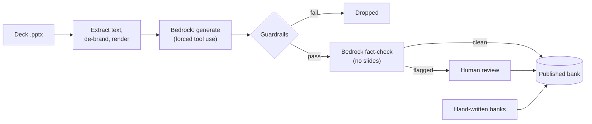
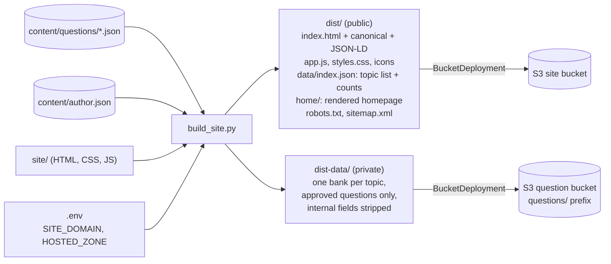
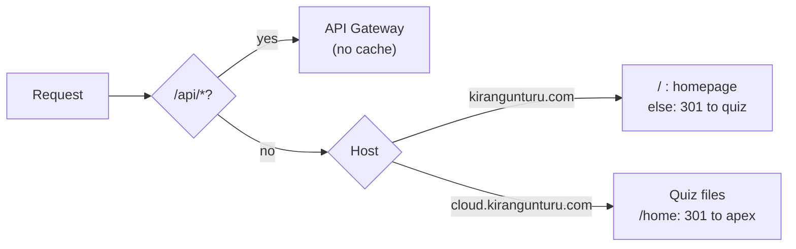
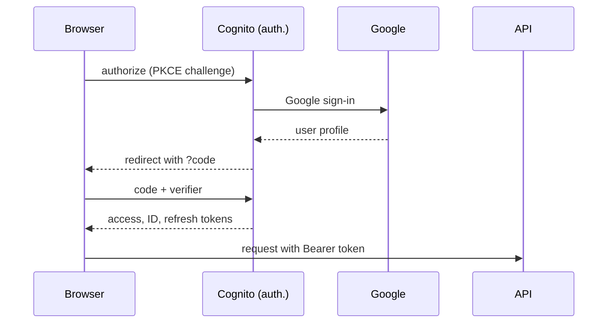
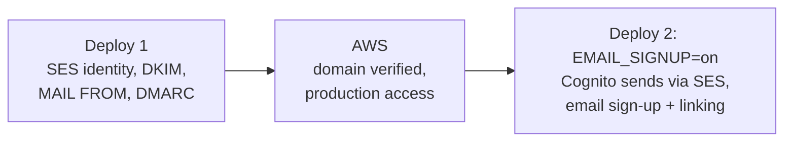
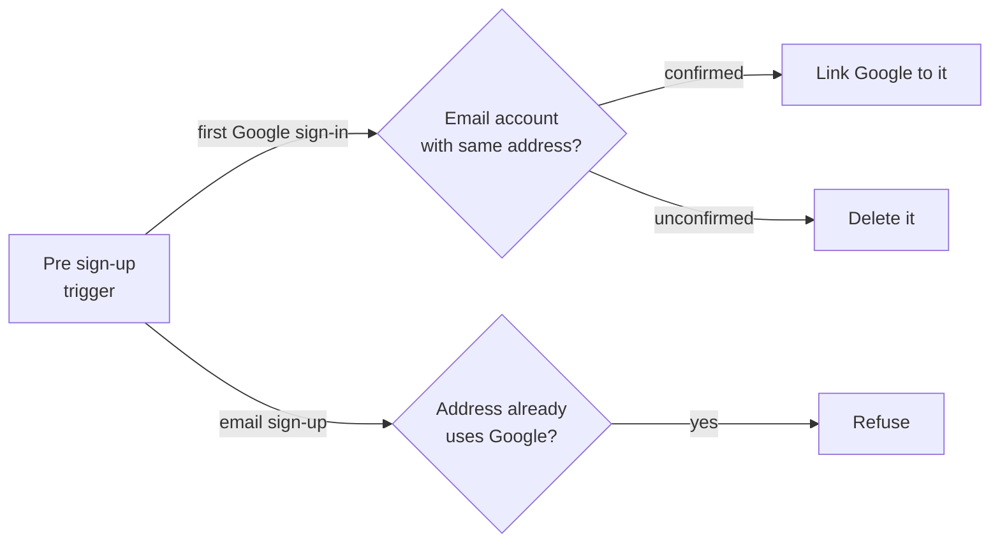
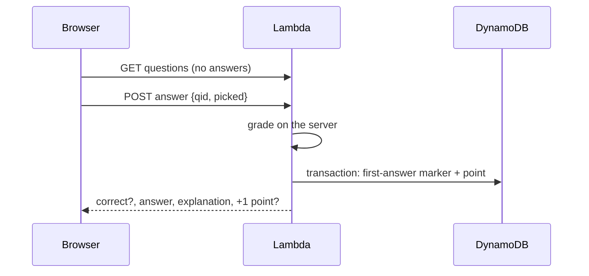
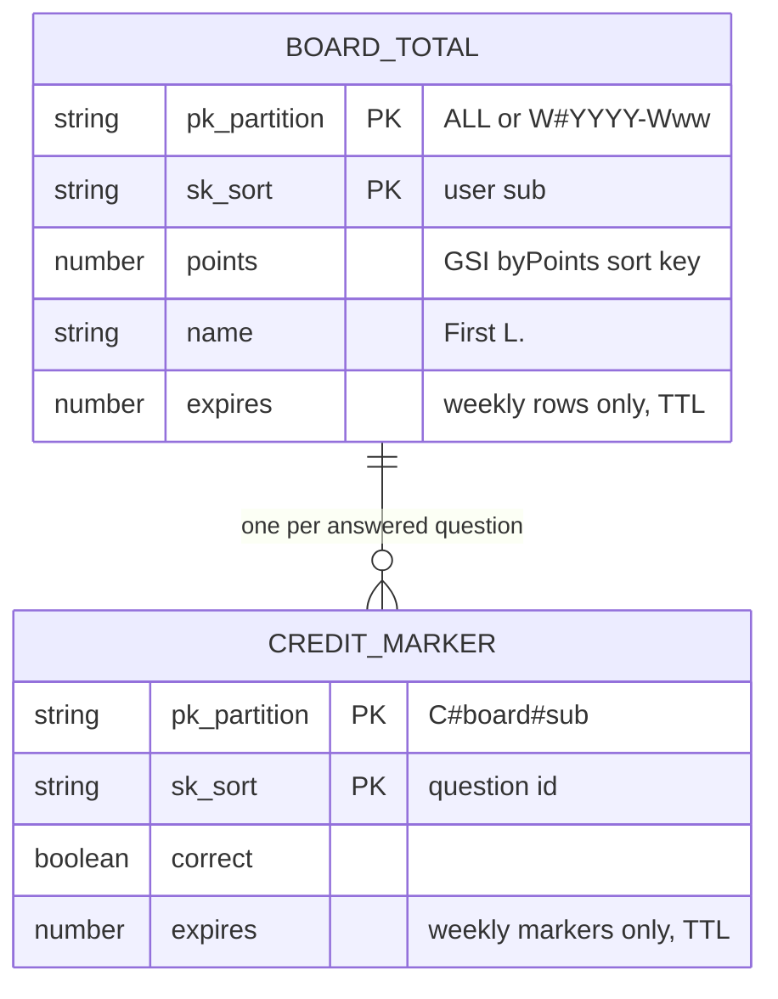
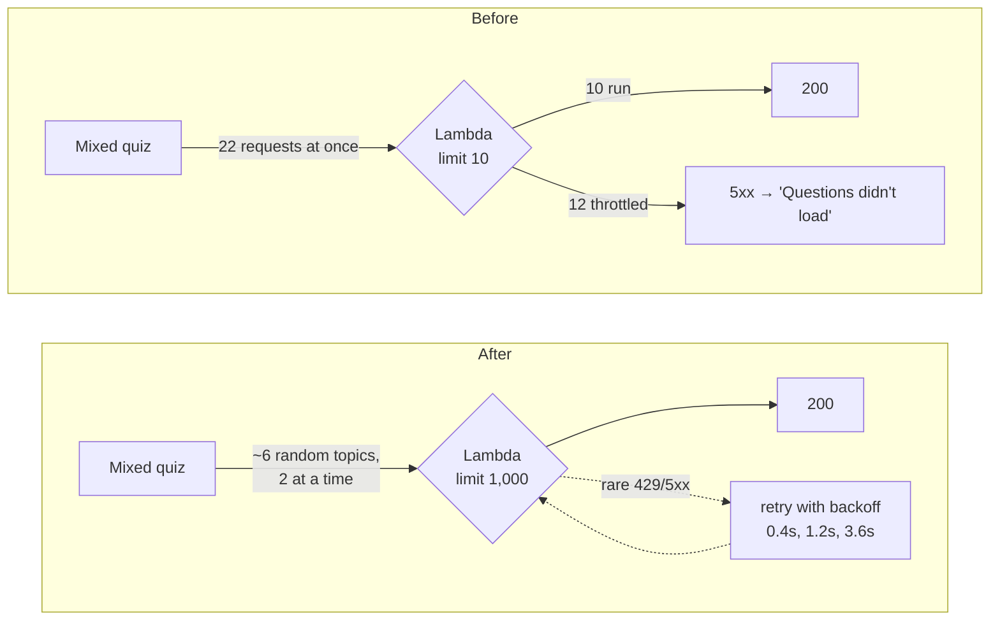

# Know Your Cloud

**Short, practical AWS quizzes for engineers, with an explanation for every answer.**

- Quiz: **https://cloud.kirangunturu.com**
- Author homepage: **https://kirangunturu.com**

Know Your Cloud turns real engineering material into practice questions: training decks, proofs of
concept, project lessons, and AWS documentation. Each question is generated or written, fact-checked
and published as JSON. It is then served by a small serverless site that keeps the answers on the
server, saves each person's progress, and ranks players on a weekly and an all-time leaderboard.

This README explains what the project is, how every part fits together, and how to run it. Part 1
covers the design. Part 2 is the runbook (the commands you actually type).

---

## Contents

**Part 1: How it works**

1. [What it does](#1-what-it-does)
2. [Architecture at a glance](#2-architecture-at-a-glance)
3. [Repository layout](#3-repository-layout)
4. [Content pipeline: from deck to published question](#4-content-pipeline-from-deck-to-published-question)
5. [Build: two outputs, one public and one private](#5-build-two-outputs-one-public-and-one-private)
6. [Infrastructure (AWS CDK)](#6-infrastructure-aws-cdk)
7. [The edge: CloudFront, two hostnames, one URL per page](#7-the-edge-cloudfront-two-hostnames-one-url-per-page)
8. [Sign-in: Google through Amazon Cognito](#8-sign-in-google-through-amazon-cognito)
9. [Email sign-up through Amazon SES](#9-email-sign-up-through-amazon-ses)
10. [The API and server-side grading](#10-the-api-and-server-side-grading)
11. [Leaderboard data model](#11-leaderboard-data-model)
12. [Domain, DNS and certificates](#12-domain-dns-and-certificates)
13. [Search engines](#13-search-engines)
14. [Security model](#14-security-model)
15. [Cost](#15-cost)
16. [Design decisions and lessons learned](#16-design-decisions-and-lessons-learned)
17. [Incident: 503s from a 10-concurrency Lambda quota](#17-incident-503s-from-a-10-concurrency-lambda-quota)

**Part 2: Runbook**: validate, generate, review, build, deploy, and the one-time setups (custom
domain, Google sign-in, email sign-up, Search Console). It starts at [Validate](#validate).

**Prefer clicking through the AWS console?** [docs/console-setup.md](docs/console-setup.md) builds the
same infrastructure by hand, step by step, with every setting and the order to create things in.

---

# Part 1: How it works

## 1. What it does

| For a visitor | Behind the scenes |
|---|---|
| A welcome page explains the site; any topic chip goes straight to sign-in. | Signed-out visitors can only see the welcome and About pages. Questions are never public files. |
| **Continue with Google** (and, once enabled, **Sign up with email**). | Amazon Cognito managed login, authorization code flow with PKCE, no client secret in the browser. |
| 22 topics, 799 questions: single and multi-select, three difficulty levels, 5/10/20-question quizzes, or a mixed quiz. | Question banks live in a private S3 bucket. The API sends questions **without** answers. |
| Instant feedback with an explanation and a link to the AWS docs. | The browser sends its picks; a Lambda function grades them and only then returns the answer. |
| "+1 point" for a correct first answer; weekly and all-time leaderboards. | DynamoDB transactions make sure only the first answer to each question ever counts. |
| Best scores and "retry missed" follow you to any device. | Progress is stored per Cognito user in DynamoDB. |
| A personal homepage at the bare domain. | A CloudFront Function routes by hostname, so the same distribution serves both sites. |

Topics today:

| Category | Topics (questions) |
|---|---|
| Compute | Amazon EC2 (69), AWS Lambda (65), Serverless vs containers (22), EC2 vs Lambda (19), Lambda vs Fargate (17) |
| Storage | Amazon S3 (74), Amazon EBS (34), AWS Transfer Family (22) |
| Database | Amazon DynamoDB (70) |
| Networking | Amazon API Gateway (64), AWS Networking (36), Amazon CloudFront (30), Amazon Route 53 (19) |
| Integration | Amazon SQS (41), Amazon SNS (20) |
| Security | SSL/TLS and the OSI model (31), Application security on AWS (10) |
| Architecture | High availability and scalability (28), Disaster recovery on AWS (22) |
| Analytics | AWS Glue (42), Glue vs Lambda (19) |
| Developer Tools | Terraform (45) |

## 2. Architecture at a glance

Everything runs in one AWS account, in **us-east-1** (required for CloudFront certificates), and is
created by a single CDK stack, `AwsQuizSite`.

[](docs/architecture.png)

*Click the diagram for full size. Editable source: [docs/architecture.drawio](docs/architecture.drawio) (open in [diagrams.net](https://app.diagrams.net)).*

Three ideas carry the whole design:

1. **Static where possible, serverless where needed.** Pages, styles and the topic list are plain
   files on S3 behind CloudFront. Only the things that must be private or per-user (questions,
   grading, progress, leaderboard) go through the API.
2. **The browser is never trusted with answers.** Questions arrive stripped; grading and scoring
   happen on the server.
3. **Everything is one `cdk deploy`.** DNS, certificates, sign-in, email, API, tables and the site
   itself are declared in `infra/quiz_site_stack.py`. Configuration comes from `.env`.

## 3. Repository layout

```
aws-quiz/
├── content/
│   ├── questions/<topic>.json     published question banks (private, not in git)
│   ├── drafts/<topic>.json        generated questions waiting for review (private, not in git)
│   ├── icons/<topic>.svg          topic icons
│   └── author.json                name, title, bio, links (About page + homepage)
├── decks/                         source decks + services.json (private, not in git)
├── schema/question-bank.schema.json   the contract between the pipeline and the site
├── pipeline/                      deck → questions (extract, sanitize, render, generate, factcheck)
├── tools/
│   ├── validate.py                schema + semantic checks
│   ├── batch.py                   run the pipeline for every deck
│   ├── review.py                  human review CLI (approve / reject / edit / promote)
│   ├── build_site.py              builds dist/ and dist-data/, local preview server
│   └── deploy.bat                 build + validate + cdk deploy
├── site/                          the quiz front end (HTML, CSS, vanilla JS, no build step)
│   └── home/                      the personal homepage template
├── infra/
│   ├── app.py                     CDK app: reads .env, creates the stack
│   ├── quiz_site_stack.py         every AWS resource
│   └── api/
│       ├── handler.py             the quiz API (one Lambda, five routes)
│       └── presignup.py           Cognito pre sign-up trigger (account linking)
├── docs/console-setup.md          build the same infrastructure by hand in the AWS console
└── tests/                         moto-based API tests, pipeline fixtures
```

**What's in this repository, and what isn't.** The code, infrastructure, site, schema and tests are
public. The content is not: source decks, rendered slides, question banks (published and drafts),
`deny-terms.txt` and `.env` are listed in `.gitignore` and stay on the author's machine. They reach
AWS only through `tools\deploy.bat`, and the questions then live in a private bucket served to
signed-in users. To try the project yourself, write a bank that follows
`schema/question-bank.schema.json` (or generate one from your own deck) into `content/questions/`.

## 4. Content pipeline: from deck to published question

Questions come from two sources:

- **Decks:** training and reference slides, run through an automated Bedrock pipeline.
- **Hand-authored banks:** engineering notes, AWS decision guides and documentation pages, and
  real project lessons. For example, the DynamoDB questions on sort-key design come from a production
  sorting issue. These are written directly as JSON. They go through the same validation and
  review gates as the generated ones.



How the guardrails work:

- **Structured output, not free text.** `generate.py` calls Bedrock's Converse API with a single tool
  whose input schema *is* the question format, and forces the model to call it. The result is JSON
  that either validates or is rejected; there is no text parsing.
- **Grounding.** Every generated question cites the slide it came from (`slideRef`), and the
  generator checks that slide was really in the request.
- **Confidentiality.** Decks are de-branded before rendering, repeated footer lines (like
  "Confidential" banners) are stripped before anything is sent, and every question is scanned for
  12-digit numbers (account IDs) and a git-ignored `deny-terms.txt` list of internal names.
- **An independent fact-check.** `factcheck.py` asks a second model pass to judge each question the
  way a learner meets it, *without* the slides. It flags issues such as
  `wrong_answer`, `other_option_correct`, `ambiguous`, `outdated`, `needs_slide`, `internal_detail`,
  `price_or_volatile`, `trivial` and `duplicate`. Only clean questions publish automatically.
- **Humans have the last word.** Anything flagged waits in `content/drafts/` for `review.py`.
  Rejected questions stay there, so re-running the generator never brings them back.

The contract every bank follows (`schema/question-bank.schema.json`):

| Field | Notes |
|---|---|
| `id` | `<topic-id>-NNN`, never reused once published |
| `type` | `single` or `multi` |
| `style` | `recall`, `scenario`, `best-fit` |
| `difficulty` | `easy`, `medium`, `hard` |
| `options` | 2–6 options, ids `a`..`f` in order |
| `answer` | list of option ids (single = 1, multi = 2+ but not all) |
| `explanation` | shown after answering |
| `slideRef` / `docUrl` | link back to the deck slide / AWS docs |
| `status` | `draft` → `approved` / `rejected`; only `approved` is published |

## 5. Build: two outputs, one public and one private

`tools/build_site.py` validates every published bank, then splits the content in two:



`dist/` is safe to publish: it says how many questions each topic has, never what they are.
`dist-data/` goes to a bucket that only the API function can read.

The front end (`site/app.js`) is plain JavaScript with no framework and no build
step. It uses hash routing (`#/`, `#/service/dynamodb`, `#/quiz/…`, `#/leaderboard`, `#/about`),
builds the DOM with a tiny `h()` helper, and supports full keyboard play: 1–6 to choose, Enter to
check and continue.

## 6. Infrastructure (AWS CDK)

All resources live in one stack, created from `infra/quiz_site_stack.py`:

| Area | Resources | Notes |
|---|---|---|
| Static site | S3 bucket, CloudFront distribution, Origin Access Control, response headers policy, BucketDeployment | Bucket blocks all public access; only CloudFront can read it. Every deploy invalidates the cache. |
| Edge logic | CloudFront Function `HostRouter` | Homepage at the bare domain, quiz at `cloud.`; see section 7. |
| API | API Gateway HTTP API (`$default` stage, 20 req/s, burst 40), JWT authorizer, Lambda `ApiFunction` | Routes under `/api/*` share the site's domain, so no CORS. |
| Data | S3 question bucket, DynamoDB `Progress`, DynamoDB `Leaderboard` + `byPoints` GSI | On-demand billing, point-in-time recovery, kept if the stack is deleted. |
| Sign-in | Cognito user pool (Essentials plan, managed login v2), app client, prefix domain + custom domain `auth.`, Google identity provider, branding | User pool has deletion protection and is retained. |
| Email | SES domain identity with Easy DKIM, custom MAIL FROM `mail.`, DMARC record, pre sign-up Lambda `AccountLinker` | Cognito switches to SES only when `EMAIL_SIGNUP=on` (section 9). |
| Domain | ACM certificate (site + apex + auth), Route 53 alias records, Search Console TXT | All DNS validation is automatic. |
| Logs | CloudWatch log groups for both functions | One-month retention. |

Configuration is read by `infra/app.py` from `.env`, so nothing personal is hard-coded:

| Variable | Effect |
|---|---|
| `SITE_DOMAIN`, `HOSTED_ZONE` | Custom domain, certificate, DNS records, homepage routing, SES identity |
| `AUTH_DOMAIN` | Sign-in host (default `auth.<zone>`; `none` keeps the amazoncognito.com address) |
| `GOOGLE_CLIENT_ID` | Turns on Google sign-in; the secret is read from Secrets Manager |
| `EMAIL_SIGNUP=on` | Email + password next to Google, sent through SES |
| `GOOGLE_SITE_VERIFICATION` | Route 53 TXT record for Google Search Console |

The stack also writes `config.json` into the site at deploy time (sign-in domain, client ID, which
sign-in options are on), so the front end never needs hand-copied IDs.

## 7. The edge: CloudFront, two hostnames, one URL per page

One distribution answers for both `cloud.kirangunturu.com` (the quiz) and `kirangunturu.com` (the
homepage). The bare domain must exist anyway: Cognito only accepts `auth.kirangunturu.com` if its
parent domain has an A record. A CloudFront Function decides what each request gets:



Every response, including API responses, gets the same security headers:

- **Content-Security-Policy:** scripts only from the site itself. Fonts come from Google Fonts. The
  browser may connect only to the site and the Cognito sign-in domain. No objects, no framing.
- **Strict-Transport-Security:** one year, including subdomains.
- **X-Content-Type-Options, X-Frame-Options: DENY,** and a strict referrer policy.

## 8. Sign-in: Google through Amazon Cognito

The site is a public client (code in a browser can't keep a secret), so it uses the **authorization
code flow with PKCE**. Cognito brokers Google sign-in; the site never talks to Google directly and
never sees a password.



Details worth knowing:

- **Tokens:** the access and ID tokens last 1 hour and the refresh token 30 days. `app.js` refreshes
  a minute before expiry, and retries once on a 401.
- **Sign-out** revokes the refresh token (`/oauth2/revoke`) and ends the Cognito session (`/logout`),
  so the next sign-in asks again.
- **Deep links survive sign-in.** Opening `#/service/dynamodb` while signed out stores that address,
  signs in, and lands you there.
- **The Google client secret** lives in Secrets Manager and is resolved by CloudFormation at deploy
  time. It never appears in `.env`, the template or the repo.
- **Names for the leaderboard** come from Google's profile (`given_name`, `family_name`), read by the
  API with `AdminGetUser` and shown as "First L.". Emails are never shown.

## 9. Email sign-up through Amazon SES

At first the site offered email + password using Cognito's built-in sender. The verification codes
landed in spam, so the site went **Google-only**. Email sign-up comes back through **Amazon SES on our
own domain**, with the authentication records that inbox providers check.

It's switched on in two deploys, because Cognito only accepts a verified SES identity, and SES can
only email real people after AWS moves the account out of the SES sandbox:



**One person, one account.** If someone signs up with email and later uses Google with the same
address, they would end up as two Cognito users with two scores. The pre sign-up trigger
(`infra/api/presignup.py`) prevents that:



Cognito fails the one sign-in during which it links accounts ("Already found an entry for
username"). `app.js` recognizes that message and silently restarts the Google sign-in once, which
then succeeds without a new prompt.

Email accounts have no name, so after the first sign-in the site asks "What should we call you?" once
(`PUT /api/profile`). The API saves it to Cognito and renames any existing leaderboard rows.

## 10. The API and server-side grading

One Lambda function (`infra/api/handler.py`) serves every route. API Gateway rejects any request
without a valid Cognito access token before the function runs, and the function takes the user's
identity only from the verified token claims (`sub`), never from the request body.

| Route | What it does |
|---|---|
| `GET /api/questions/{topic}` | The topic's questions **without** `answer` and `explanation`; adds `need` (how many options to pick) |
| `POST /api/start` | `{qid}` → records when the user first opened the question (starts the 90-second points window) |
| `POST /api/answer` | `{qid, picked[], left}` → grades on the server, records points, returns the answer and explanation |
| `GET /api/leaderboard?board=week\|all` | Top 25 with competition ranking, plus the caller's own rank |
| `GET /api/progress` / `PUT /api/progress` | Best score per topic and missed question IDs |
| `GET /api/profile` / `PUT /api/profile` | Leaderboard name, and whether the user still needs to choose one |



Input is validated before anything is stored. Bodies are capped at 64 KB, IDs must match strict
patterns, and saved progress is rebuilt field by field so nothing unexpected is kept.

## 11. Leaderboard data model

The `Leaderboard` table holds two kinds of items in one key space:

| Item | `pk` | `sk` | Attributes |
|---|---|---|---|
| Board total | `ALL` or `W#2026-W42` | user `sub` | `points`, `name`, `updatedAt` (`expires` on weekly rows) |
| Credit marker | `C#<board>#<sub>` | question id, e.g. `dynamodb-041` | `correct` (`expires` on weekly markers) |



- **First answer counts, exactly once.** Each answer writes its credit marker with
  `attribute_not_exists(pk)`, in the same transaction as the `ADD points :one`. A second answer to the
  same question cancels the whole transaction, so retakes, retries and guessing every option earn
  nothing, even with parallel requests.
- **Points need a prompt answer, in the foreground.** A right first answer scores only if it arrives within
  90 seconds of `POST /api/start` and the page never went to the background (`left: false`, set by the browser on a
  tab or app switch, or more than 2 seconds without focus). Otherwise it's still graded and explained, and still
  uses up the first answer, but scores nothing. Question text can't be selected or copied. Together these make
  pasting questions into another tool pointless for the leaderboard; `S#<sub>` items hold the "first seen" times.
- **Ranking without scans.** The `byPoints` GSI (`pk` + `points`) returns the top 25 of a board in one
  query. Your own rank is 1 + the number of players with more points, a `COUNT` query on the same
  index. Credit markers have no `points` attribute, so they never enter the index.
- **Weekly reset without a job.** Weeks are ISO weeks in UTC (they start Monday 00:00 UTC), so a new
  week is simply a new `pk`. Old weekly items expire through DynamoDB TTL after about two weeks.

The `Progress` table is one item per user (`userId` = Cognito `sub`) holding a small JSON document.

## 12. Domain, DNS and certificates

The domain is registered in Route 53, which created the hosted zone. Everything else is declared in
the stack:

| Record | Points to | Why |
|---|---|---|
| `kirangunturu.com` A/AAAA | CloudFront | homepage (and required parent for `auth.`) |
| `cloud.kirangunturu.com` A/AAAA | CloudFront | the quiz |
| `auth.kirangunturu.com` A | Cognito's CloudFront | sign-in pages |
| `_xxxx` CNAMEs | ACM | certificate validation |
| 3 × `_domainkey` CNAMEs | SES | DKIM signing |
| `mail.kirangunturu.com` MX + TXT | SES | custom MAIL FROM (SPF) |
| `_dmarc` TXT | (none) | DMARC policy |
| apex TXT | (none) | Google Search Console verification |

- One free ACM certificate covers all three names and renews itself.
- `auth.kirangunturu.com` replaces the default `quiz-xxxx.auth.us-east-1.amazoncognito.com`. Google's
  consent screen then names our own domain, and the default prefix domain keeps working for old
  redirect URIs.
- The Cognito custom domain depends on the apex A record (Cognito checks for it), and the stack
  encodes that dependency so the first deploy succeeds in one pass.

## 13. Search engines

The quiz content is behind sign-in and uses hash routes, so on its own it gives search engines very
little to index. The build adds what they need:

- **A personal homepage** (`kirangunturu.com`) rendered from `content/author.json`, with
  `ProfilePage` + `Person` structured data (name, job title, location, and `sameAs` links to GitHub,
  GitLab and the quiz). Name searches find this page.
- **A canonical URL** for the quiz and `WebSite` structured data naming its author.
- **`robots.txt` and `sitemap.xml`** for each hostname (the API is disallowed).
- **One URL per page.** The host router's redirects stop Google from seeing two copies of the site.
- **Domain verification** in Google Search Console through a Route 53 TXT record.

## 14. Security model

| Threat | Control |
|---|---|
| Reading answers from the page or network | Answers never leave the server before an answer is submitted. Banks sit in a private bucket readable only by the API role. |
| Inflating leaderboard points | Server-side grading, one transaction per answer, `attribute_not_exists` markers, throttling at 20 req/s per API. |
| Calling the API as someone else | JWT authorizer validates signature, issuer, expiry and audience; the user id comes from the token, not the request. |
| Stolen tokens in transit | HTTPS only (TLS 1.2+), HSTS, PKCE for the code exchange, no client secret in the browser. |
| Script injection | Strict CSP (no inline scripts, no third-party scripts), DOM built with `textContent`, never `innerHTML` from data. |
| Clickjacking | `X-Frame-Options: DENY` and `frame-ancestors 'none'`. |
| Direct S3 access | Buckets block all public access; CloudFront reads through Origin Access Control; TLS enforced. |
| Account takeover through email linking | Google is linked only to **confirmed** email accounts. Unconfirmed ones are deleted instead. |
| Email spoofing of the domain | DKIM, SPF on the MAIL FROM domain, and DMARC `p=quarantine`. |
| Accidental data loss | Retained buckets, tables and user pool; point-in-time recovery on both tables; user pool deletion protection. |
| Leaking internal details into questions | De-branding, footer stripping, deny-term and account-id scans, an AI `internal_detail` check, human review. |
| Secrets in code | Google client secret in Secrets Manager; `.env` and `deny-terms.txt` git-ignored. |

## 15. Cost

At hobby traffic the site costs a few dollars a month, mostly fixed items:

| Item | Approximate cost |
|---|---|
| Domain registration | about $15 / year |
| Route 53 hosted zone | $0.50 / month |
| Secrets Manager (Google secret) | $0.40 / month |
| ACM certificate | free |
| CloudFront, S3, Lambda, API Gateway, DynamoDB (on demand) | cents at this scale, much of it inside the free tier |
| Cognito Essentials | free tier covers up to 10,000 monthly active users (at the time of writing) |
| SES | $0.10 per 1,000 emails |

## 16. Design decisions and lessons learned

- **Server-side grading from day one of the leaderboard.** A leaderboard is only meaningful if the
  browser can't see answers. Moving grading to the API was the price of adding one.
- **"First answer counts" makes scoring fair and simple.** No need to detect cheating patterns: a
  retake simply can't score, and DynamoDB transactions make it race-free.
- **Google-only first, email second.** The built-in Cognito sender put verification codes in spam,
  which looked like a broken site. Google sign-in removed email from the problem. Email returned only
  with SES, DKIM, SPF and DMARC on our own domain.
- **Two-phase rollouts for things AWS must approve.** SES verification and production access are
  outside our control, so the stack creates the prerequisites first and gates the switch behind
  `EMAIL_SIGNUP`.
- **A real lock, not a hidden button.** Visitors could tap topic chips that did nothing until they
  signed in, which confused people. Now every chip starts sign-in and then lands in that topic.
- **Own the sign-in domain.** With the default Cognito domain, Google's consent screen showed
  `quiz-xxxx.auth.us-east-1.amazoncognito.com`. A custom `auth.` domain shows ours.
- **One distribution, two sites.** A 15-line CloudFront Function is cheaper and simpler than a
  second bucket, distribution and certificate for a one-page homepage.
- **No build step for the front end.** Vanilla JS keeps the site small, auditable and easy to
  change. The only "build" is copying files and splitting public from private data.
- **Honest credibility.** The site says what the questions are built from (real projects, proofs
  of concept, engineering notes), that answers are checked against the AWS docs, and that they are
  reviewed and corrected over time. It doesn't claim more than that.

## 17. Incident: 503s from a 10-concurrency Lambda quota

**What happened.** A friend in India opened the quiz and got "Questions didn't load … returned 503". The site
worked for me, and nothing was deployed at the time.

**Why.** Two things combined:

1. **The account's Lambda concurrency limit was 10, not 1,000.** New AWS accounts start with reduced quotas,
   which AWS raises over time as the account is used.
   `aws lambda get-account-settings --query "AccountLimit.ConcurrentExecutions"` returned `10`.
2. **The mixed quiz requested every topic at once.** Starting a mixed quiz fetched all 22 question banks
   in parallel, so a single visitor could ask for 22 concurrent Lambda executions. Anything past 10 was
   throttled, API Gateway returned a 5xx, and the page gave up on the first failure. A token refresh at the
   same moment made it worse: every one of those requests tried to refresh the token on its own.

Where the user was had nothing to do with it. CloudFront's price class (North America and Europe edges)
only adds latency for visitors in India; it doesn't cause errors.



**How it was fixed.**

| Layer | Change |
|---|---|
| Quota | Requested the standard 1,000 concurrent executions (Service Quotas → AWS Lambda → Concurrent executions, quota code `L-B99A9384`). AWS approved it the same day (2026-10-14). |
| Mixed quiz | Loads about 6 random topics, 2 requests at a time, and adds more only if a difficulty filter leaves too few questions. "Retry missed" loads only the topics those questions came from. A mixed quiz went from 22 concurrent requests to at most 2. |
| API client | Retries 429, 500, 502, 503 and 504 responses and network errors up to 3 times with exponential backoff and jitter (~0.4 s, 1.2 s, 3.6 s). |
| Sign-in | Concurrent requests share one token refresh instead of each refreshing on its own. |
| Error page | Says the server is busy and offers **Try again**, instead of a developer message about `file://` pages. |

**How it was verified.** A local mock API returned 503 for the first three requests: the mixed quiz still
started, with at most 2 requests in flight. With the API down entirely, the friendly error page appeared.
To confirm in AWS, check the function's `Throttles` metric in CloudWatch.

**Lessons.**

- **Check account quotas before you share a link.** New accounts are not sized like the documentation's
  defaults. Lambda concurrency, SES sending and EC2 vCPUs all start lower.
- **Fan-out from the browser is fan-out on your backend.** `Promise.all` over 22 URLs is 22 concurrent
  Lambdas. Load only what the screen needs, and cap parallelism.
- **Clients should expect transient failures.** Throttling, cold starts and deploys all produce brief
  5xx responses. A small, bounded retry turns them into a pause instead of an error page.

---

# Part 2: Runbook

The sections below are the operational reference: the commands to run and the one-time console
steps. To build the infrastructure by hand instead of with CDK, follow
[docs/console-setup.md](docs/console-setup.md).

## Validate

```bash
pip install jsonschema
python tools/validate.py                  # all banks
python tools/validate.py --approved-only  # gate before publishing
```

## Generate questions from a deck

Run everything from the project folder (the one with this README).

```powershell
pip install -r requirements.txt

# 1. See what the model will be sent (no AWS calls)
python pipeline\generate.py decks\s3.pptx --service s3 --name "Amazon S3" --category Storage --dry-run

# 2. Generate drafts with Bedrock (needs AWS creds + model access in the region)
#    one-time: Copy-Item .env.example .env, then set AWS_PROFILE in .env
python pipeline\generate.py decks\s3.pptx --service s3 --name "Amazon S3" --category Storage --deny-terms deny-terms.txt
```

`.env` holds `BEDROCK_MODEL_ID`, `AWS_REGION` and `AWS_PROFILE` and is git-ignored; a variable set in
the shell (`$env:BEDROCK_MODEL_ID = "..."`) overrides it for that session.

Drafts go to `content/drafts/<service>.json` with `status: draft`. Each generated question is:

- validated against the schema and semantic rules (bad ones are dropped with a reason)
- checked that `slideRef` is a slide that was actually sent
- scanned for 12-digit numbers (account ids) and any term in `--deny-terms`
- de-duplicated against published questions and existing drafts, so re-runs are safe

Slides titled Agenda / Questions / Thank you are skipped. Lines repeated on most slides
(footers, "Confidential" banners) are stripped before anything is sent.

### Diagrams and images

Slides with diagrams, SmartArt, screenshots or charts are rendered to PNG and sent to the model
alongside their text (`--images auto`, the default). `--images all` sends every slide as an image;
`--images none` is text only. Renders are cached in `build/renders/<deck>/`.

Rendering uses PowerPoint on Windows (`pip install pywin32`, included in requirements) or
LibreOffice anywhere else (`soffice` on PATH or `LIBREOFFICE_PATH`, plus `pymupdf`).
Check it works on its own with `python pipeline\render.py decks\lambda.pptx`.
Keep `deny-terms.txt` (internal system, team and company names) out of git.

Test offline: `python tests/fixtures/make_sample_deck.py` then run `generate.py` on
`tests/fixtures/s3-sample.pptx` with `--mock-response tests/fixtures/mock_tool_input.json
--deny-terms tests/fixtures/deny-terms.txt`.

## Batch: all decks at once

`decks/services.json` maps decks to services (a service can have several decks). Then:

```bat
python tools\batch.py --list      :: what will run
python tools\batch.py             :: generate, fact-check, publish what passes
```

Each deck is generated, then a second Bedrock pass fact-checks every question without seeing the
slides. Questions that pass are approved and published to `content/questions/` automatically;
flagged ones stay in `content/drafts/` with the reason, for `python tools\review.py <id>`.
`--review` turns auto-approval off. Decks that already produced questions are skipped on re-runs.
Set `REVIEW_MODEL_ID` in `.env` to use a different model for the fact-check.

## Review and publish

```powershell
python tools\review.py s3             # a=approve r=reject e=edit s=skip q=quit (saves after each)
python tools\review.py s3 --list      # counts
python tools\review.py s3 --promote   # approved -> content\questions\s3.json
python tools\validate.py --approved-only
```

`e` opens the question JSON in Notepad (or `$env:EDITOR`, e.g. `"code --wait"`); edits are
validated before they're accepted. Rejected questions stay in `content/drafts/` so re-running
`generate.py` won't produce them again.

## Quiz site

Plain HTML, CSS and JS in `site/`, no build tools. `tools/build_site.py` validates the published
banks, then writes two folders:

- `dist/`: the public site (pages, icons, `data/index.json` topic list, `data/author.json`)
- `dist-data/`: one `<service>.json` per service (approved questions only, internal fields stripped).
  These are never public files; the API serves them only to signed-in users.

```powershell
python tools\build_site.py --serve      # build and open http://localhost:8000
```

The local preview has no sign-in: it stands in for the API itself (questions from `dist-data/`,
progress kept in memory until you stop it).

Features: service table coloured by AWS category, quiz length and difficulty, single and
multi-select questions, instant explanation with docs link and slide reference, keyboard
(1-6 to choose, Enter to check / continue), results with "retry missed", best score per service.
Visitors who aren't signed in see a welcome page (and About); everything else needs an account.
Best scores and missed questions are saved to the user's account.

## Deploy (S3 + CloudFront + Cognito + API)

`infra/` is a CDK app (Python):

- **Site**: private S3 bucket, CloudFront with Origin Access Control, HTTPS only, security headers
  (CSP, HSTS, no framing), cache invalidation on every deploy.
- **Sign-in**: Cognito user pool (Google; email + password only when Google isn't set up) with the
  managed login pages at `https://quiz-xxxxxxxx.auth.us-east-1.amazoncognito.com`. The site uses the
  authorization code flow with PKCE; there is no client secret.
- **API** at `/api/*` on the same CloudFront domain: HTTP API with a Cognito JWT authorizer, one Lambda
  (`infra/api/handler.py`), questions from a second private bucket, progress and the leaderboard in
  DynamoDB (`userId` = Cognito `sub`). Throttled to 20 req/s, burst 40.
- `config.json` (sign-in domain and client id) is written into the site at deploy time.

Deployed to us-east-1 so a custom domain can be added later. The user pool, progress table and
buckets are kept if the stack is deleted (user pool also has deletion protection).

Change the look of the sign-in pages in the Cognito console: User pools → aws-quiz-users →
Managed login → Edit style. Email sign-up sends its codes through Amazon SES on your own domain
(see **Email sign-up**), never through Cognito's built-in sender, which tends to land in spam.

One-time setup (cmd, venv active):

```bat
pip install -r infra\requirements.txt
npm install -g aws-cdk
cd infra && cdk bootstrap && cd ..
```

Every deploy:

```bat
tools\deploy.bat
```

It builds `dist\`, re-validates, then runs `cdk deploy`; the site URL is printed as `AwsQuizSite.SiteUrl`.
To use your own domain, see **Custom domain** below.

The bucket is kept if the stack is deleted (`RemovalPolicy.RETAIN`); empty and delete it by hand if
you tear everything down.

## Leaderboard

- **Points:** one per question, decided by your *first* answer to it. Retakes and guessing
  every option earn nothing. The weekly board counts your first answer to each question in that
  week and resets Monday 00:00 UTC.
- **Server-side grading:** the browser never receives answers or explanations. `GET /api/questions/{id}`
  strips them (it sends `need`, the number of answers to pick). `POST /api/answer` grades on the
  server, records the point, and returns the answer and explanation.
- **Names:** shown as first name + last initial from the Google profile ("Kiran G."); emails never appear.
  Players without a name show as "Player XXXX".
- **Storage:** a `Leaderboard` DynamoDB table holds board totals (`pk` = `ALL` or `W#2026-W41`,
  `sk` = user) with a `byPoints` index, and "already answered" markers (`pk` = `C#<board>#<user>`,
  `sk` = question id). Weekly items expire through TTL.
- **Local preview:** `build_site.py --serve` emulates this with an in-memory board and three
  sample players.

Tests: `pip install "moto[dynamodb,s3,cognitoidp]" pytest`, then `python -m pytest tests/test_api_handler.py`.

## Custom domain

Register the domain in Route 53 (it creates the hosted zone), then add to `.env`:

```
SITE_DOMAIN=cloud.kirangunturu.com
HOSTED_ZONE=kirangunturu.com
```

The next `tools\deploy.bat` then:

- creates one HTTPS certificate (in us-east-1) for the site, the bare domain and `auth.<zone>`, validated
  through DNS automatically;
- points `cloud.kirangunturu.com` and `kirangunturu.com` at the site (Cognito requires the bare domain
  to have an A record before it accepts `auth.kirangunturu.com`, and visitors to the bare domain get the
  quiz until it has its own page);
- moves the sign-in pages to `auth.kirangunturu.com`, so Google says "Sign in to kirangunturu.com".
  The old amazoncognito.com address keeps working too.

**Before that deploy**, add the new sign-in address to the Google OAuth client (keep the old entries):

- Authorized JavaScript origins: `https://auth.kirangunturu.com`
- Authorized redirect URIs: `https://auth.kirangunturu.com/oauth2/idpresponse`
- Google Auth Platform → Branding → Authorized domains: `kirangunturu.com`

The first deploy with a domain takes longer (certificate validation plus Cognito's custom domain,
up to about 30 minutes). Set `AUTH_DOMAIN=none` to keep sign-in on the amazoncognito.com address.

## Email sign-up (next to Google)

Off by default: with Google set up, Google is the only way in. Turning email + password on takes two
deploys, because Cognito only accepts an SES domain that is already verified, and SES can only email
real people once AWS moves the account out of the SES "sandbox".

**Deploy 1: set up the domain for email.** Any deploy with `HOSTED_ZONE` set creates, in Route 53:

- three DKIM records (SES signs every email, so receivers can tell it really came from you)
- `mail.<zone>` MX and SPF records (the "MAIL FROM" domain bounces go to)
- `_dmarc.<zone>`: tells Gmail and Outlook to treat unsigned mail claiming your domain as spam

Then, in the SES console (us-east-1):

1. **Identities → kirangunturu.com** should show *Verified* within about 15 minutes.
2. **Account dashboard → Request production access**: mail type *Transactional*, website
   `https://cloud.kirangunturu.com`, and describe the use: sign-up verification codes and password
   resets for a free quiz site, sent only to people who sign up themselves, with bounces and
   complaints handled by SES. AWS usually answers within a day.

**Deploy 2: turn it on.** Once both are done, add `EMAIL_SIGNUP=on` to `.env` and run
`tools\deploy.bat`. That:

- sends Cognito's emails through SES as `Know Your Cloud <no-reply@kirangunturu.com>`
- turns self sign-up on and adds email + password next to Google on the sign-in page
- shows "Continue with Google" and "Sign up with email" on the welcome page

**One person, one account.** A pre sign-up Lambda (`infra/api/presignup.py`) keeps the two ways in
from splitting someone's scores:

- Google sign-in for an address that already has a confirmed email account joins the two (same
  scores, same leaderboard row). Cognito fails that one attempt; the site retries it automatically.
- Email sign-up for an address that already signs in with Google is refused with "use Continue with
  Google".
- An email account that never confirmed its code is removed when that address signs in with Google.

**Names.** Email accounts have no name, so after their first sign-in the site asks once: "What should
we call you?" (`PUT /api/profile`). The leaderboard shows it as first name + last initial.

SES costs $0.10 per 1,000 emails. To turn email sign-up off again, remove `EMAIL_SIGNUP` and deploy;
existing email accounts stay but can't sign in until it's back on.

## Search (Google)

With `SITE_DOMAIN` and `HOSTED_ZONE` set, each build also writes:

- **A personal homepage** at the bare domain (`https://kirangunturu.com/`), built from
  `content/author.json` (name, title, location, `bio` paragraphs, `links`) into `dist/home/`. It carries
  "ProfilePage" structured data that tells Google whose site this is, and lists your profiles as
  `sameAs`. A CloudFront Function serves it for the bare domain and redirects every other bare-domain
  path to the quiz address, so each page has exactly one URL.
- **A canonical tag** on the quiz (`https://cloud.kirangunturu.com/`) and "WebSite" structured data
  naming you as the author.
- **`robots.txt` and `sitemap.xml`** for both addresses (the API is disallowed).

Add LinkedIn and other profiles to `links` in `content/author.json`, and put the homepage URL on those
profiles too: links in both directions are how Google ties your name to the site.

**Google Search Console** (one-time):

1. https://search.google.com/search-console → Add property → **Domain** → `kirangunturu.com`.
2. Copy the TXT value it shows (`google-site-verification=...`) into `.env` as
   `GOOGLE_SITE_VERIFICATION=...`, run `tools\deploy.bat`, then click **Verify**.
3. **Sitemaps** → submit `https://kirangunturu.com/sitemap.xml` and
   `https://cloud.kirangunturu.com/sitemap.xml`.
4. **URL inspection** → enter `https://kirangunturu.com/` → **Request indexing** (same for the quiz).

Keep the TXT record: Search Console re-checks it, and removing it removes your access.

## Google sign-in

Unless email sign-up is on, Google is the only way to sign in once `GOOGLE_CLIENT_ID` is set in `.env` and the client secret is in
Secrets Manager: no passwords and no email codes (self sign-up is turned off; Google users are created
on their first sign-in). Without a Google client the pool falls back to email + password.

1. Deploy once (`tools\deploy.bat`) and note two outputs: `AwsQuizSite.SignInDomain` and
   `AwsQuizSite.GoogleRedirectUri`.
2. In the Google Cloud console (any project), open **Google Auth Platform**:
   - **Branding**: app name ("Know Your Cloud"), support email, and under authorized domains
     add `amazoncognito.com` (plus your own domain if you use one).
   - **Audience**: External, then **Publish app**. While it's in "Testing", only listed test users
     can sign in. The scopes used (openid, email, profile) don't need Google verification.
   - **Clients → Create client → Web application**:
     - Authorized JavaScript origins: the `SignInDomain` value
     - Authorized redirect URIs: the `GoogleRedirectUri` value (`.../oauth2/idpresponse`)
3. Store the client secret (cmd; add `--profile your-profile` if you use one):

   ```bat
   aws secretsmanager create-secret --region us-east-1 --name aws-quiz/google-client-secret --secret-string "GOCSPX-..."
   ```

4. Put the client ID in `.env`: `GOOGLE_CLIENT_ID=1234...apps.googleusercontent.com`
5. `tools\deploy.bat` again. The welcome page shows a single "Continue with Google" button that goes
   straight to Google.

The secret is read by CloudFormation at deploy time and never written to the template or `.env`.
A Secrets Manager secret costs about $0.40 a month.

## Build order

1. **Contract + seed content** ← done
2. **Pipeline: python-pptx extraction → Bedrock drafts → AI fact-check → review → promote** ← done (local CLI)
3. **Static quiz site** ← done (`site/`, `tools/build_site.py`)
4. **CDK: S3 + CloudFront + Route 53 custom domain** ← done (`infra/`, `tools/deploy.bat`)
5. **Cognito sign-in (Google), API Gateway, Lambda, DynamoDB for progress** ← done
6. **Server-side grading + weekly / all-time leaderboard** ← done
7. **Personal homepage, structured data, sitemaps, Search Console** ← done
8. **Email sign-up through SES with account linking** ← built; switched on after SES production access
9. Next ideas: public topic pages with sample questions, share-preview image, "report a problem"
   link, CloudWatch alarms and a budget alert, a review console
